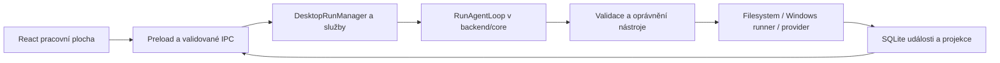

# R3 — desktopová architektura

Stav implementace k 1. listopadu 2026. Tento popis vychází ze zdrojů; runtime výsledky a jejich omezení jsou v [akceptaci](../r3-acceptance.md). Navazuje na [R2 lifecycle](r2-change-lifecycle.md), [projektovou identitu](r2-project-identity.md) a [provider kontrakt](r2-provider-contract.md). PRD autoritu zachovává [v1.1](../../PRD_v1.1.md).

## Hranice a jedna cesta operace

Renderer (React část vykreslující okno) nemá Node, filesystem, procesy ani SQLite. `main.ts` nastavuje `sandbox:true`, `contextIsolation:true`, `nodeIntegration:false`; zakazuje nová okna, webview a cizí navigaci. Preload vystavuje pouze omezené IPC (komunikaci mezi oknem a hlavním procesem). Handler kontroluje vstup, odesílatele/frame i vlastnictví ID, chyby překládá na bezpečný tvar. Testovací driver nenabízí produkční IPC pro volnou cestu nebo shell.

Autor má vysvětlit tento konkrétní tok: odeslání zprávy → trvalé přijetí → backendová smyčka → rozhodnutí oprávnění patche (pravidlo nebo schválení) → hashově chráněná změna → schválení skutečného testu → záznam ověření navázaný na revizi → diff → potvrzený návrat pouze agentních změn. Text modelu nevytváří úspěšný verification record (trvalý záznam provedené kontroly).

## Databáze a identity

[Seznam migrací](../../backend/infrastructure/src/persistence/migrations.ts) přidává ke schématu R2 následující verze. Migrace mají checksum; společné připojení SQLite vlastní R3 infrastruktura a vnořený R2 runtime je nezavírá.

| Verze | Uložený význam |
| --- | --- |
| 10 `r3_desktop_chats` | `desktop_projects`, `chats`, `desktop_jobs`, `chat_messages`; unikátní requestId, vstupní digest, vstup a descriptor modelu; jediný queued/running/stopping job na projekt. Zpráva a job se přijímají atomicky; archivace aktivního chatu je zakázaná. |
| 11 `r3_desktop_projections` | Kurzor chatu, aktualizace, vazby aktivity na kanonické eventy, assistant chunky a stdout/stderr, action intent pro návrat, coverage ověřování, vlastnictví a výsledek příkazu. |
| 12 `r3_provider_settings` | Volba demo/openai, limit kroků, verze klíče, výsledek testu a verze souhlasu. Žádný plaintext klíč. |

`requestId` označuje klientský záměr odeslání, `jobId` backendem přijatou práci a `runId` běh vytvořený jádrem. `DesktopRunManager` po validaci zjistí již uložený požadavek: shodný vstup vrátí původní přijetí, jiný vstup skončí `R3_REQUEST_MISMATCH`. Aktivní projekt je odmítnut před demo preflightem. SQLite zůstává další pojistkou souběhu. `onRunCreated` připojí skutečné runId k jobu i zprávám; ID se nevymýšlí v rendereru. Retry je nový požadavek s `retryOfRequestId`, nikoli automatické přehrání.

Pro návrat je uložen samostatný action intent (trvalý záměr akce). Vstup obsahuje pozorovanou sekvenci change setu a revizi workspace; opakování stejného requestu nezvětšuje potvrzený rozsah. Čerstvý preflight pod projektovým operation lease (výhradní oprávnění k operaci) chrání proti souběžné změně. Uživatelovy původní staged/unstaged/untracked změny se neztotožňují s prací agenta.

## Projekce, stream a odběr změn

Projekce je odvozený čtecí pohled z trvalých dat, snapshot úplný aktuální pohled a kurzor jeho pořadové číslo. Migrační triggery přidávají aktualizace a propojují události přes session/tool call vazbu i request. `run.inspect` zpřístupňuje starší běhy a `run.activity` stránkuje jejich aktivitu; poslední běh nepřepisuje historický diff.

`SubscriptionService.attach` registruje odběratele před načtením snapshotu a potom použije jeho kurzor. Poll probíhá po 50 ms; příliš velký backlog (>256 aktualizací nebo >1 MiB), mezera kurzoru či vypršená retence vyvolá `resync_required` a nový snapshot. DB uchovává posledních 1024 aktualizací chatu. IPC adaptér eviduje vlastníka odběru a potvrzené kurzory, odpojuje při překročení limitu, zániku nebo reloadu rendereru. Renderer ignoruje staré aktualizace; obnovení pohledu nezpouští nástroje.

Model i stdout/stderr procházejí redakcí tajemství před uložením a předáním. UTF-8 decoder zachovává hranice znaků, `StreamBatcher` dávkuje po 4096 B/50 ms a terminální stav čeká na drain (dopsání fronty). Chyba zápisu přeruší běh. Chrání se také finální text a legacy výsledek R2; samotný redaktor streamu by nestačil. HTML z modelu se vykresluje jako text. Neúplné token usage (spotřeba tokenů) se označí neznámé, ne jako nula.

## Oprávnění, relevance a lifecycle

Permission broker čeká na konkrétní ID/digest; odpověď ověřuje vlastnictví chatu/projektu a aktuálnost. Povolení ani zákaz nemají rendererem tvrzený výsledek. Automatické rule decisions mají uložený důvod. Stejný R2 harness stále hlídá kořen, realpath/junction, citlivé cesty, expected hash a konkrétní schválený příkaz.

Referenční profil pokrývá konkrétní `sum.mjs` a test, nikoli obecný TypeScript projekt. Coverage (rozsah ověřených cest) rozlišuje plné, částečné a neověřené změny. Nová revize nebo ruční změna může z historického úspěchu udělat stale (zastaralý) důkaz; aktuální stav určuje backend.

Close controller nejprve zamkne příjem nových operací, vyžádá souhlas s ukončením a čeká na stop. Nepotvrzený stop ponechá UI i DB otevřené. Při startu recovery přeruší nedokončené action intents, ověří vlastněné procesy a potom přeruší nedokončené job/message a uzavře stará approval. Windows worker sleduje hostitele a podporovaný strom potomků; vlastnictví obsahuje PID i creation time a výsledek zastavení je trvalý. Restart automaticky neopakuje model ani nástroje. Nejistá procesní nebo mutation recovery blokuje nový běh. Jde o řízení podporovaného stromu, nikoli obecný filesystem/network sandbox.

## Tajemství a přenos dat

`SecretProtector` je úzký backendový port. Electron adaptér mapuje async safeStorage decrypt objekt na `value`/`shouldReEncrypt`, Windows DPAPI chrání pro účet. `EncryptedSecretStore` odmítá plaintext fallback, aliasy a nevyhovující ACL (oprávnění adresáře); nahrazuje přes privátní temp soubor, fsync a rename. Společná provider lease serializuje běh/test klíče a výměnu/odstranění; keyVersion váže test na konkrétní klíč. Selhání metadata zápisu nesmí zaměnit použitou verzi.

Uložení/test klíče neznamená souhlas s projektovým přenosem. `settings.ensureProjectTransmissionAllowed` požaduje aktuální consentVersion před prvním live requestem. Otevření složky samo neposílá projekt. Providerem zůstává autorem zvolený OpenAI Responses `gpt-6-luna`; demo používá scripted model nad skutečnými službami. Cena a live limity nejsou dokazované offline testem. Podrobnosti ochrany a packaged měření: [ADR 0008](../decisions/0008-r3-secret-storage.md).

## Ověřitelné zdroje

- [Composition root](../../apps/desktop/src/composition-root.ts), [main](../../apps/desktop/src/main.ts), [IPC handler](../../apps/desktop/src/ipc/r3-handler.ts), [subscriptions](../../apps/desktop/src/ipc/r3-subscriptions.ts).
- [R3 infrastruktura](../../backend/infrastructure/src/create-r3-infrastructure.ts), [run manager](../../backend/core/src/desktop/run-manager.ts), [subscription service](../../backend/core/src/desktop/subscription-service.ts), [runtime factory](../../backend/infrastructure/src/model/r3-runtime-factory.ts).
- [Chat persistence test](../../backend/infrastructure/test/r3-chat-persistence.test.ts), [projekce](../../backend/infrastructure/test/r3-projection-store.test.ts), [run manager](../../backend/infrastructure/test/r3-run-manager.test.ts), [secrets](../../backend/infrastructure/test/r3-secret-store.test.ts).
- Skutečné Electron důkazy: [workflow](../../tests/desktop/r3-workflow.test.ts), [lifecycle](../../tests/desktop/r3-lifecycle.test.ts), [adverse](../../tests/desktop/r3-adverse.test.ts), [secrets](../../tests/desktop/r3-secrets.test.ts), [packaged](../../tests/packaged/r3-smoke.test.ts).
